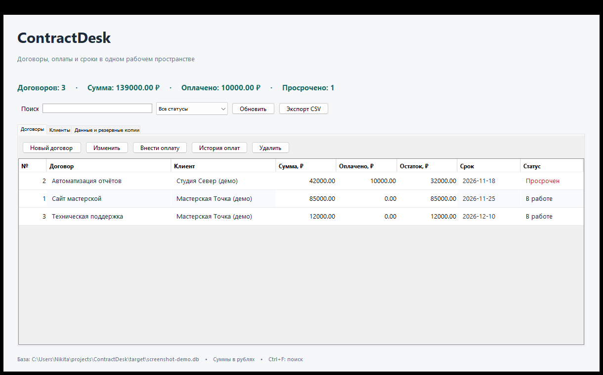

# ContractDesk

Windows releases include a ZIP with a bundled Java runtime. Extract it and launch `ContractDesk.exe`. To build this package locally, run `package-windows.ps1` after Maven with `JAVA_HOME` pointing to JDK 21+.

[Русский](README.md)

A local desktop CRM for freelancers and small studios. Manage clients, contracts, deadlines and partial payments without a server or an account. The application interface is in Russian.



## Features

- Client and contract CRUD, notes, deadline reminders and overdue status.
- Partial payments, payment history and overpayment prevention. Money is stored as integer kopecks.
- Search, status filters and sortable tables.
- CSV export preserves the visible filter and sort order; UTF-8 BOM and formula escaping support spreadsheet use.
- SQLite backup and validated restore. The previous live database is backed up before replacement.
- Explicit demo mode with fictional records, available for an empty database.

## Stack and quick start

Java 17+, Swing, JDBC, SQLite, Maven and JUnit 5.

```sh
mvn clean verify
java -jar target/contractdesk-1.0.0.jar --demo
```

The JAR bundles its dependencies. A Java 17+ runtime is required. Windows users can use `build.ps1` and `run.ps1 -Demo`.

Use `--data ./demo.db --demo` for a separate demo database. The default database is `~/.contractdesk/contractdesk.db`. Data never leaves the computer. Keep databases and backups out of source control.

## Walkthrough

Launch the demo, select a contract, record a partial payment and open payment history. Filter overdue contracts and export them. Create a backup from the data tab, change a record and restore the snapshot. The application reports the location of the automatically saved previous database.

Double-click a record to edit it. `Ctrl+F` focuses search. Dates use `YYYY-MM-DD`; monetary values are rubles with at most two decimal places.

## Structure and tests

`App` provides the Swing UI and actions. `Store` owns SQL operations and payment transactions. `Client` and `Contract` are records. `Money` handles exact decimal conversion; `Csv` handles export. Tests cover payment limits, foreign keys, backup/restore, overdue dates and CSV escaping.

## Scope

Single-user local application with RUB amounts. No network synchronization, database encryption, attachments or accounting integration. Deleting a contract deletes its payment history after confirmation. Protect the computer and backup files appropriately.

## License and author

MIT, see [LICENSE](LICENSE). Author: Никита, [Fr1bilder](https://github.com/Fr1bilder), `nikitazadan89@yandex.ru`.

CI template: `ci/build.yml`. Automatic CI is not enabled. Move this file to `.github/workflows/build.yml` using credentials with workflow permissions. Nine tests cover real SQLite data, money, CSV and WAL-safe recovery.
