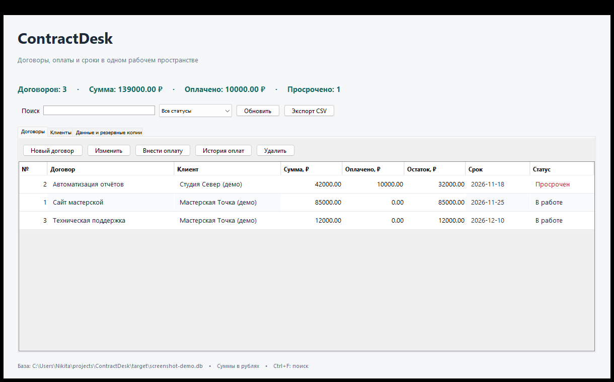

# ContractDesk

[English](README.en.md)

Настольная CRM для фрилансера и небольшой студии: клиенты, договоры, частичные оплаты и сроки. Работает локально, хранит данные в SQLite, не требует сервера или регистрации.



## Возможности

- Создание, редактирование и удаление клиентов и договоров.
- Дедлайны, автоматическое выделение просроченных договоров и напоминание о ближайших сроках при открытии.
- Частичные оплаты с историей и проверкой переплаты. Суммы хранятся целым числом копеек.
- Поиск по названию, клиенту и заметкам, фильтр статусов, сортировка таблицы.
- Экспорт отфильтрованного списка в CSV с сохранением текущего порядка сортировки. UTF-8 BOM для Excel, экранирование формул.
- Резервное копирование SQLite и восстановление с проверкой целостности. Перед заменой текущая база сохраняется отдельной копией.
- Демонстрационные данные, которые загружаются только в пустую базу.

## Стек

Java 17+, Swing, JDBC, SQLite, Maven, JUnit 5. Один JAR включает зависимости и SQLite-драйвер для Windows, Linux и macOS. Для запуска требуется установленная Java 17 или новее.

## Быстрый старт

```powershell
mvn clean verify
java -jar target/contractdesk-1.0.0.jar --demo
```

На Windows также доступны `build.ps1` и `run.ps1 -Demo`. Пример отдельной демонстрационной базы:

В релизах есть Windows ZIP со встроенной Java: распакуйте архив и запустите `ContractDesk.exe`. Для самостоятельного создания такого пакета после сборки выполните `package-windows.ps1` с `JAVA_HOME`, указывающим на JDK 21+.

```powershell
java -jar target/contractdesk-1.0.0.jar --data ./demo.db --demo
```

Без `--data` рабочая база находится в домашней папке пользователя: `.contractdesk/contractdesk.db`. Данные не отправляются в сеть. Не добавляйте рабочую базу и её копии в Git.

## Как проверить основной сценарий

1. Запустите приложение с `--demo`. Названия и контакты примеров вымышленные.
2. Выберите договор, внесите часть оставшейся оплаты, откройте историю.
3. Отфильтруйте просроченные договоры и экспортируйте список в CSV.
4. На вкладке данных создайте резервную копию под новым именем.
5. Измените запись, восстановите копию. Программа покажет путь к автоматически сохранённой предыдущей базе.

Двойной щелчок открывает редактор записи. `Ctrl+F` переводит фокус в поиск. Даты вводятся в формате `ГГГГ-ММ-ДД`, суммы в рублях с максимум двумя знаками после запятой.

## Архитектура

`App` содержит Swing-представление и обработчики пользовательских действий. `Store` отвечает за SQL и транзакции. `Client` и `Contract` описывают записи. `Money` выполняет точные денежные преобразования, `Csv` экспортирует данные. Девять тестов проверяют платежи, ограничения связей, копирование и восстановление, снимки WAL, отклонение некорректных оплат, сроки и CSV. Шаблон CI находится в `ci/build.yml`; для включения перенесите его в `.github/workflows/build.yml` с доступом к workflows. Автоматический CI пока не включён.

## Ограничения

Однопользовательский локальный инструмент. Валюта интерфейса: рубли. Нет сетевой синхронизации, шифрования базы, вложений и интеграции с бухгалтерией. Удаление договора удаляет его историю оплат после подтверждения. Защищённые копии и контроль доступа к компьютеру остаются ответственностью владельца.

## Лицензия и автор

MIT, см. [LICENSE](LICENSE). Автор: Никита, [Fr1bilder](https://github.com/Fr1bilder), `nikitazadan89@yandex.ru`.
